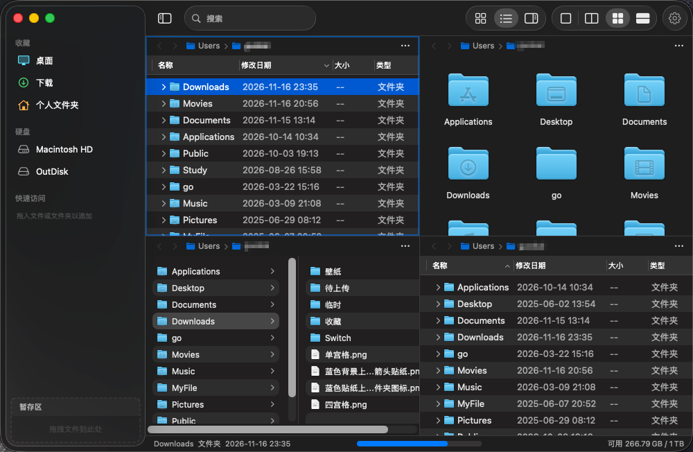

<p align="center">
  
</p>

<h1 align="center">Swifile</h1>

<p align="center">
  <b>原生、轻量、多窗格的 macOS 文件管理器</b><br>
  多窗格、可编辑路径栏、暂存区、快速访问，一个窗口完成文件整理与搬运。
</p>

<p align="center">
  
  
  
  
</p>

<p align="center">
  
</p>

<p align="center"><sub>四窗格 · 列表 / 图标 / 分栏三种视图同屏</sub></p>

## 为什么是 Swifile

| 原生 | 轻量 | 高效 |
|---|---|---|
| 100% SwiftUI + AppKit，不套 Electron，不内嵌浏览器 | 安装包约 2.8 MB，启动快、占用低 | 后台读取目录 + FSEvents 实时同步 + 快照缓存，操作不卡主线程 |

## 功能

- **多窗格布局**：单窗格 / 双窗格 / 四窗格 / 一加二，每个窗格独立导航
- **三种视图**：图标宫格、列表（支持行内展开目录）、分栏（Miller columns）
- **实时同步**：FSEvents 监听当前目录与展开目录，访达里的增删改、改名会自动同步
- **缩略图预览**：图片、PDF、视频、音频、文本和 Office 文档自动生成预览图标
- **可编辑路径栏**：面包屑逐级跳转；点路径空白处或按 `⌘L` 直接输入路径，支持 `~`、相对路径和带引号路径
- **暂存区**：拖入收集，多选后复制 / 移动到活动窗格，也可以直接拖出
- **快速访问**：把常用文件或文件夹拖进来即可添加引用
- **收藏**：在设置里自选系统目录，侧栏保持清爽
- **搜索与排序**：即时过滤；按名称、大小、日期、类型排序，目录优先
- **打开方式**：右键悬停列出系统推荐应用；终端与图片、视频、音频、PDF、文本、压缩包可分别指定默认应用
- **编辑动作**：新建后直接改名、`Return` 重命名、`⌘C` / `⌘X` / `⌘V` 拷贝剪切粘贴、`⌘D` 制作副本
- **原生交互**：右键菜单、在 Finder 中打开、在终端中打开、窗口内设置
- **主题**：跟随系统 / 浅色 / 深色

## 免费使用

Swifile 对个人和非商业用途免费，源码公开，可自行构建。

商业使用需要取得作者授权，详见 [商业授权说明](COMMERCIAL_LICENSE.md)。

## 下载与安装

当前版本：`1.2.0`，DMG 约 2.8 MB。更新内容见 [CHANGELOG](CHANGELOG.md)。

1. 从 [GitHub Releases](https://github.com/Leviathangk/Swifile/releases/latest) 下载 DMG
2. 打开 DMG，把 Swifile 拖进 Applications
3. 首次启动按提示授予桌面、下载、文稿等目录访问权限

> 当前构建为本地签名，未做 Developer ID 公证。首次打开如果被 Gatekeeper 拦截，请右键应用 → 打开。正式分发前会补齐签名和公证。

## 从源码构建

工程文件不入库，由 `project.yml` 生成：

```bash
brew install xcodegen
xcodegen generate
open Swifile.xcodeproj
```

不装 xcodegen 也可以直接编译一个可执行文件：

```bash
xcrun swiftc -O -j 2 \
  -swift-version 5 \
  -target arm64-apple-macos14.0 \
  -module-name Swifile \
  -o Swifile \
  $(find Swifile -name '*.swift')
```

当前直接构建目标是 Apple Silicon（arm64）。

## 本地开发

如果本机 Xcode 因为插件问题无法正常 Run，可以用 `scripts` 里的脚本：

```bash
./scripts/dev.sh              # 构建当前工作区并启动开发包
./scripts/dev.sh --build-only # 只构建，不启动
./scripts/dev.sh --debug      # 使用 -Onone -g，方便断点
./scripts/test.sh             # 手工构建并运行 XCTest
```

开发包输出到 `build/dev/Swifile.app`，日志在 `build/dev/Swifile.log`。没有热重载，改完代码重新执行 `dev.sh`。

<details>
<summary>技术细节</summary>

- 目录枚举在后台线程产出不可变快照，UI 只消费快照，读写分离
- 相同目录请求合并 + 快照缓存 + 目录监听失效
- 列表视图用 NSTableView 桥接实现「按下即选中」
- 图标加载区分窗格优先级，非活动窗格只保留占位图，避免后台窗格抢占导航

性能自检：

```bash
SWIFILE_PERF_BENCH=1 ./Swifile
```

覆盖 4000 项冷加载、缓存命中、过滤排序、窗格冷加载、搜索、连续选择、四窗格切换等门禁。

</details>

## 许可证

本项目采用 [PolyForm Noncommercial License 1.0.0](LICENSE)：个人和非商业用途免费，商业使用需取得授权。

代码公开，但这不是 OSI 定义的开源许可证；源码公开不等于允许商业使用。

<p align="center">
  如果 Swifile 对你有帮助，欢迎点一个 Star，或到 <a href="https://github.com/Leviathangk/Swifile/issues">Issues</a> 反馈问题。
</p>
